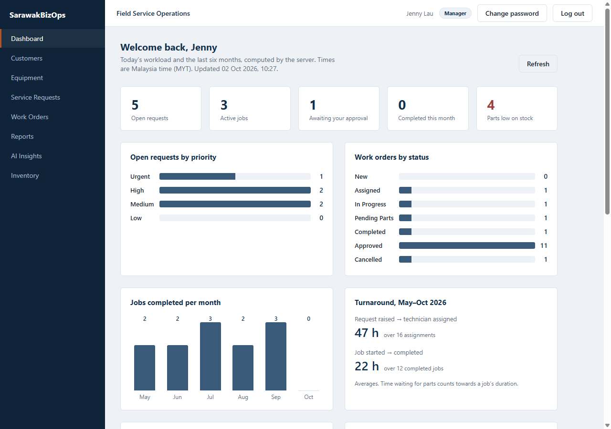
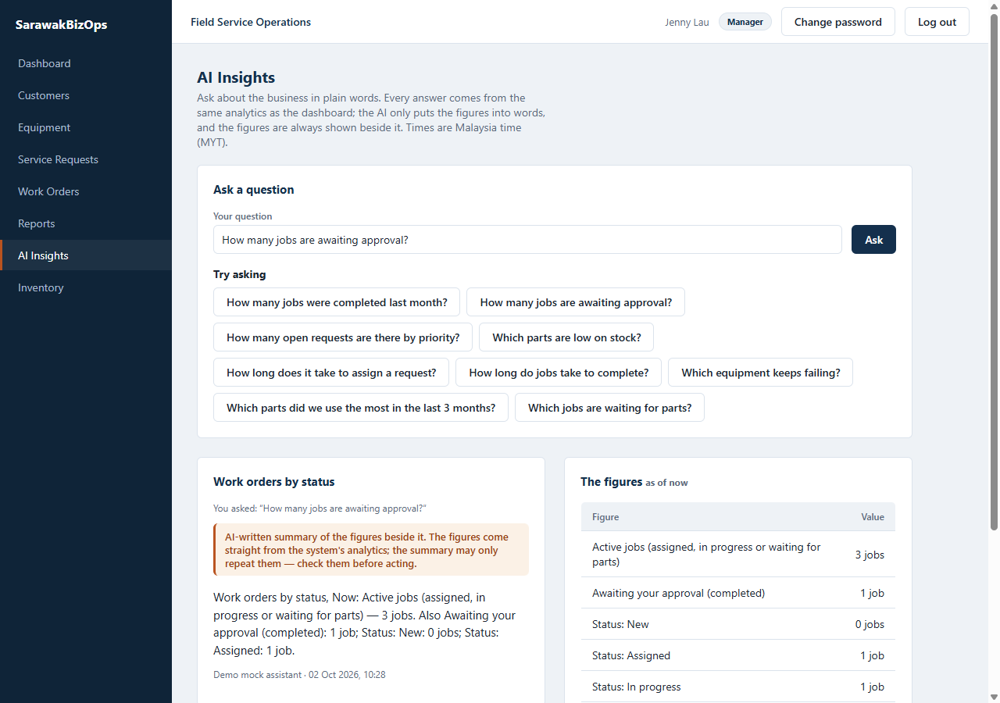
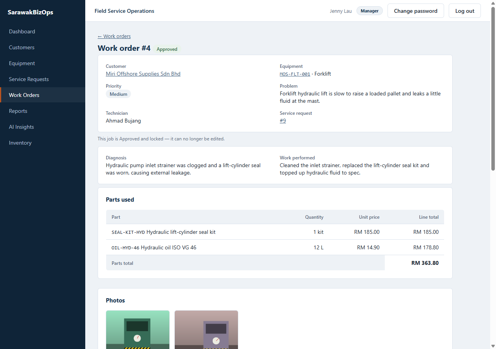
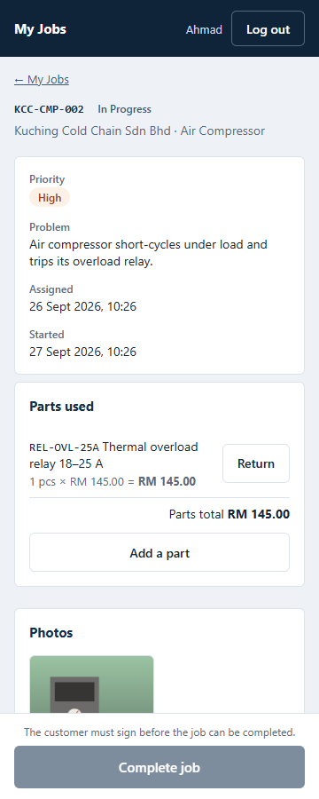
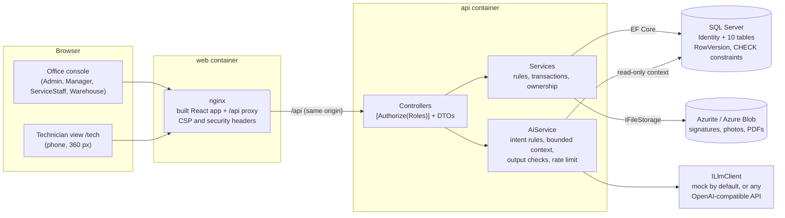
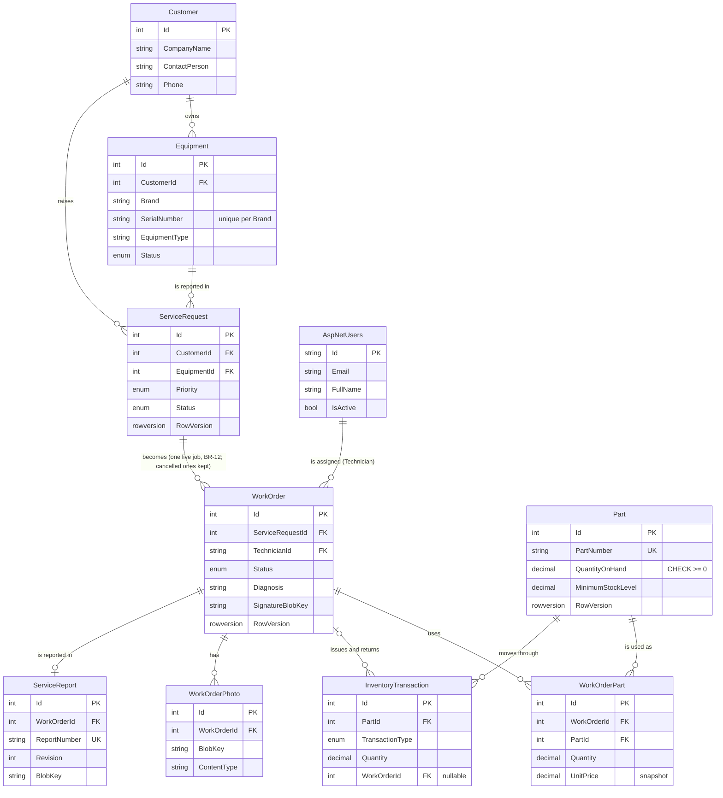
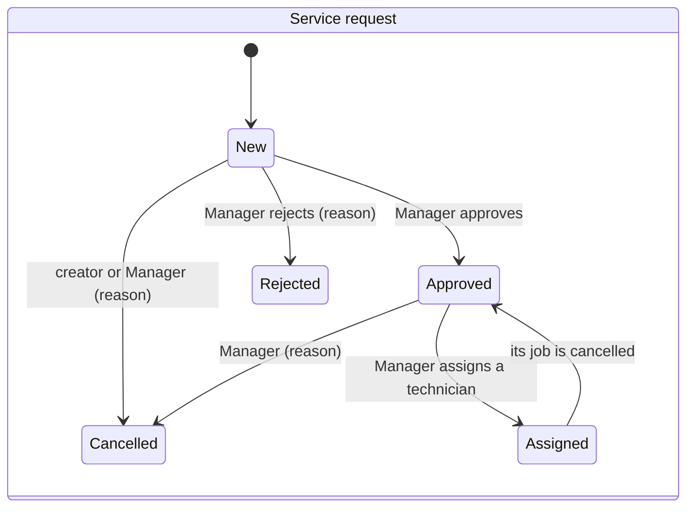
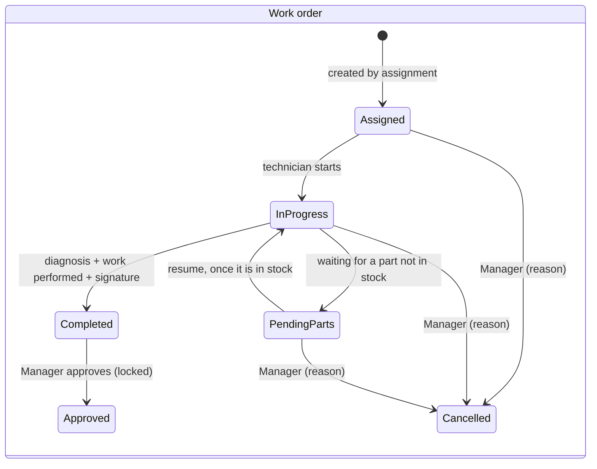

# SarawakBizOps

**Field-service operations for a (fictional) Sarawak industrial-equipment servicing company** — from a customer's
problem report to an approved, signed, photographed, parts-accounted service report, with dashboards and two
grounded AI assistants on top.

```
Customer report → Service request → Manager approval → Technician assignment → Work order
→ Field work on a phone (diagnosis, parts, photos, signature) → Completion → Service report (PDF)
→ Manager approval (locks the job) → Dashboards and AI insights
```

[](../../actions/workflows/ci.yml)
&nbsp;**Stack:** ASP.NET Core 10 · EF Core · SQL Server · ASP.NET Identity + JWT · React 18 + TypeScript (Vite) ·
Azure Blob Storage (Azurite) · Docker · GitHub Actions

| Manager dashboard | AI insights with the figures beside the summary |
|---|---|
|  |  |
| **Work order with its timeline, parts, photos and signature** | **The technician's job on a 360 px phone** |
|  |  |

## Why it is interesting

- **The backend is the system of record.** Every rule — who may do what, which status may follow which, a locked job
  stays locked, stock never goes below zero — is enforced by the API and proven by tests, whatever the UI shows.
- **Concurrency is designed, not hoped for.** Stock moves through one conditional `UPDATE` in the same transaction as
  its immutable ledger row; every mutating call carries a `rowVersion`, so a stale screen gets a clear 409. Racing
  tests prove exactly one winner and that stock always equals the sum of its ledger.
- **AI that cannot make numbers up.** The Manager's question is mapped by rules to one of the dashboard's analytics
  operations; the model sees only the resulting figures (never the question or raw rows), and a summary containing any
  number that is not one of those figures is dropped. The technician assistant gets a bounded, read-only context.
  Both run on a deterministic mock by default, so the demo needs no key.
- **Few dependencies.** The PDF writer, the signature pad and the charts are hand-rolled; each library that *was* added
  is listed with its reason ([Dependencies and why](#dependencies-and-why)).
- **One command to run, one table to secure.** `docker compose up` gives a seeded, working system; every route is
  called as anonymous and as each of the five roles in one test table (AC-11), and a test fails if a route is missing
  from it.

## Quick start

```bash
docker compose up --build        # then open http://localhost:8080
```

Sign in as any demo role with the password `Demo!2026` — `manager@`, `staff@`, `technician@`, `warehouse@` or
`admin@sarawakbizops.local` (details in [Run with Docker](#run-with-docker-recommended)).

**A five-minute tour**

1. **Manager** — the dashboard (open requests, jobs by status, completed per month, low stock, turnaround). Approve a
   **New** request and assign it to Ahmad Bujang under **Work orders**.
2. **Technician** (open it on a phone, or narrow the window) — **My jobs** → the job → Start → write the diagnosis →
   add a part → take a photo → have the customer sign → Complete. Try completing before signing: the API refuses.
3. **Manager** — open the completed job, **Generate report**, read the PDF, **Approve**. The job is now locked.
4. **Warehouse** — the part you used is on the ledger as an Issue for that job; receive stock for a low part.
5. **Manager** — **AI Insights**: *How many jobs are awaiting approval?* gives a summary with the same figures beside
   it; *What was our revenue last month?* is refused with the list of what can be asked.

## Documents

**Status:** phases 0–15 of the plan are done — every feature in the PRD's scope, AC-01…AC-11 each proven by named
tests. Phase 16 (a React Native technician app) is a stretch goal and not started.

| Document | What it holds |
|---|---|
| [`docs/features.md`](./docs/features.md) | Every feature in depth: its rules, endpoints and a demo script, phase by phase |
| [`docs/decisions.md`](./docs/decisions.md) | The decision log: the PRD's design decisions, every open question and how it was settled |
| System Design Document v1.1, PRD and build plan | The original design (data model, lifecycles, BR-01…14, AC-01…11), the product requirements that amend it, and the phase-by-phase plan; not in this repository. The PRD wins where they differ ([why there is no v1.2](./docs/decisions.md#open-question-7--how-the-sdd-is-kept-up-to-date)). |

## Architecture



- **Layering:** `Controller (thin) → Service (rules, transactions) → ApplicationDbContext`, DTOs in and out, manual
  mapping, no repository layer. The web app is a thin client over the API (`fetch` wrapper, React Context, plain CSS).
- **One origin.** nginx serves the app and proxies `/api`, so the browser needs no CORS and no base-URL setup.
- **AI behind a seam.** `ILlmClient` has a deterministic mock and one hand-rolled OpenAI-compatible client; the AI
  reads data through a context whose interceptor allows `SELECT` only.

## Data model



Files live in blob storage; the database keeps their keys. `InventoryTransaction` is append-only — no route edits or
deletes a row, and a database trigger refuses any UPDATE or DELETE whoever sends it — and `Part.QuantityOnHand` always equals the sum of its rows (checked after every stock-moving test).
Who created, approved, rejected or cancelled a record is a user id and a UTC timestamp on the record itself (D-05).

## Workflows





Approved and Cancelled are terminal: a central guard makes every mutating call on them a 409, not just status
changes (AC-07, AC-08). Every transition is one conditional `UPDATE … WHERE Status = @from AND RowVersion = @rv`, so
two people acting at once get exactly one success.

## API examples

Interactive docs: Swagger at `http://localhost:5080/swagger` in the manual setup. Through the Docker stack:

```bash
BASE=http://localhost:8080/api
TOKEN=$(curl -s $BASE/auth/login -H 'Content-Type: application/json' \
  -d '{"email":"manager@sarawakbizops.local","password":"Demo!2026"}' | jq -r .token)

# The Manager dashboard (named, tested analytics operations; months in MYT)
curl -s $BASE/dashboard/summary -H "Authorization: Bearer $TOKEN" | jq '.workOrdersByStatus'

# Approve a request: every mutating call sends the rowVersion it last saw
REQ=$(curl -s "$BASE/service-requests?status=New" -H "Authorization: Bearer $TOKEN" | jq '.[0]')
curl -s $BASE/service-requests/$(jq .id <<<"$REQ")/approve -H "Authorization: Bearer $TOKEN" \
  -H 'Content-Type: application/json' -d "{\"rowVersion\":$(jq .rowVersion <<<"$REQ")}" | jq .status
# → "Approved"; the same call again → 409 problem+json: "This request is Approved and cannot be approved. …"

# Ask the AI about the business: the figures come from the analytics, the model only words them
curl -s $BASE/ai/manager-insights -H "Authorization: Bearer $TOKEN" -H 'Content-Type: application/json' \
  -d '{"question":"How many jobs were completed last month?"}' | jq '{outcome, summary, figures}'

# A role without access is refused whatever the UI shows (AC-11)
WH=$(curl -s $BASE/auth/login -H 'Content-Type: application/json' \
  -d '{"email":"warehouse@sarawakbizops.local","password":"Demo!2026"}' | jq -r .token)
curl -s -o /dev/null -w '%{http_code}\n' $BASE/customers -H "Authorization: Bearer $WH"   # → 403
```

Errors are always RFC 7807 `application/problem+json` (validation adds an `errors` map; a 500 carries a `traceId`,
never a stack trace). Every endpoint, its roles and its rules are in [`docs/features.md`](./docs/features.md).

## Repository layout

```
src/
├── SarawakBizOps.Api/          ASP.NET Core Web API + EF Core + Identity (+ Dockerfile)
└── SarawakBizOps.Web/          React + TypeScript office console (+ Dockerfile, nginx.conf, Vitest tests in src/test)
tests/
└── SarawakBizOps.Api.Tests/    xUnit; integration tests run against real SQL Server (Testcontainers)
docs/
├── features.md                 Every feature in depth: rules, endpoints, demo scripts
├── decisions.md                Decision log: design decisions and open questions
└── screenshots/                The images in this README
scripts/
└── compose-smoke.sh            Signs in through the web container, reads data, walks request intake, the first job end to end (with photos, the signature and the service report), parts and stock, parts on a job, the Manager dashboard, each role's dashboard, the AI assistant and the AI manager insights on the mock (used by CI)
docker-compose.yml              sqlserver + azurite + api + web, one command
```

---

## Run with Docker (recommended)

The only prerequisite is [Docker](https://www.docker.com/products/docker-desktop/). No .NET SDK, Node or SQL Server install.

```bash
docker compose up --build
```

The first run pulls the SQL Server image (about 1.5 GB) and the Azurite storage emulator, and builds the API and web images, which takes a few minutes; after that it starts in under a minute. When it settles, open **<http://localhost:8080>**.

The API creates the schema and the sample data on first start. Sign in with any of these **demo-only** accounts; they all share the password `Demo!2026`:

| Role | Email |
|---|---|
| Admin | `admin@sarawakbizops.local` |
| Manager | `manager@sarawakbizops.local` |
| ServiceStaff | `staff@sarawakbizops.local` |
| Technician | `technician@sarawakbizops.local` |
| WarehouseStaff | `warehouse@sarawakbizops.local` |

> **These credentials are public and exist only for the Docker demo.** They are created only when `Seed__Demo=true`
> (set by `docker-compose.yml` and nothing else). The API refuses to start outside that mode unless you set
> `Seed:AdminPassword` yourself, so there is no built-in admin password on a real deployment.

The sample data is fictional (names, companies, phone numbers and addresses) and covers every state a reviewer might want to see without creating it first: **10 customers** across Kuching, Sibu and Miri with **30 pieces of equipment** (every status, one retired); **22 service requests** — 3 New (one Urgent), 2 Approved (one deliberately left for you to assign, one back to Approved because its job was cancelled), 15 Assigned, 1 Rejected with a reason and 1 Cancelled by its creator; and **16 work orders** — one live job in each of Assigned, InProgress (diagnosed, a relay used, waiting for the customer's signature), PendingParts (waiting for 6 m of conveyor belt that is out of stock), Completed (awaiting approval), Approved (locked, with its report) and Cancelled, plus ten approved jobs over the last four and a half months that give the dashboard its trends (one pump fails twice, so *repeated failures* has something to find). Signatures, job photos (generated drawings of machines) and service-report PDFs are created at seed time and stored in Azurite. The warehouse has a 12-part catalogue whose stock comes from 19 ledger rows, so every part reconciles with its ledger; four active parts are at or below their minimum.

| Command | What it does |
|---|---|
| `docker compose down` | Stop, keeping the database |
| `docker compose down -v` | Stop **and wipe the database and the stored files**; the next `up` re-seeds from scratch |
| `docker compose logs -f api` | Follow the API log |

**How it fits together**

- Only the web container (nginx, port 8080) is published. It serves the built React app and proxies `/api` to the API container, so the browser sees one origin: no CORS and no base-URL setup. The API base URL (`/api`) is fixed when the web image is built.
- `Database__MigrateOnStartup=true` makes the API apply EF migrations at startup, retrying while SQL Server warms up. The flag is **off by default** everywhere else, so a normal run never changes a schema on its own.
- The API is healthy (`/health/ready`) only once migrations and seeding are done, because it does its startup work before it starts listening. `/health` is a plain liveness check. Both are unauthenticated and return no data.
- The seeding is idempotent: every row is inserted only if its key (email, company name, serial number) is missing, so restarting is safe.
- Files (the customer signature, job photos and service reports) are stored in the **Azurite** container (Azure Blob Storage emulator, blob service only, data in the `blobdata` volume). The API talks to it with Azurite's well-known development account, which Microsoft publishes for the emulator — it is not a secret. The browser never reaches Azurite: every file goes through the API's authorized endpoints. Azurite's port is published on `127.0.0.1:10000` only (`AZURITE_HOST_PORT` changes it), for the manual dev setup below.
- **The API never connects as `sa`.** A one-shot `db-init` container runs [`scripts/sql/create-logins.sql`](./scripts/sql/create-logins.sql) as `sa` on every `up` and exits; it creates the database and two logins. `sarawakbizops_app` is the API's own: its database only, read/write on the data (except the stock ledger, which it may only read and append to), and schema changes because the demo migrates on startup. `sarawakbizops_ai_reader` is used by the AI features (`ConnectionStrings__AiReadOnly`) and can only `SELECT`, so SQL Server itself refuses an AI write, behind the in-app guard. Without `AiReadOnly` (manual setup, tests) the AI uses the main connection and the in-app guard alone.
- nginx passes the browser's address in `X-Forwarded-For`; the API trusts it only from proxies in `ForwardedHeaders:KnownNetworks` (the private ranges by default), so logs and anything keyed on the client IP see the real caller and a caller cannot forge its own.
- SQL Server is also published on `127.0.0.1:14330` (this machine only) if you want to connect with SSMS or Azure Data Studio: user `sa`, password `Demo_Passw0rd!`.

**Overriding the demo defaults.** Every secret in `docker-compose.yml` is a labelled, demo-only default so a fresh clone runs with no setup. To change any of them, copy [`.env.example`](./.env.example) to `.env` and uncomment the line: `WEB_PORT`, `DEMO_PASSWORD`, `JWT_KEY`, `MSSQL_SA_PASSWORD`, `APP_DB_PASSWORD`, `AI_DB_PASSWORD`, `SQL_HOST_PORT`, `AZURITE_HOST_PORT`. The session cookie is `Secure`, which
browsers accept from `http://localhost`; to open the demo over plain HTTP from another machine, set
`Auth__RefreshCookieSecure=false` on the api service, or sign-ins will not survive a page reload. The database volume keeps the old `sa` password, so run `docker compose down -v` after changing `MSSQL_SA_PASSWORD`; the two API logins pick up a new password on the next `up`.

**Smoke test.** [`scripts/compose-smoke.sh`](./scripts/compose-smoke.sh) drives the running stack through the web container with `curl` and `jq`, the way the browser does (each record's `rowVersion` included): every role signs in; the seed is there; request intake (raise, approve, reject, wrong roles and invalid moves refused); a first job end to end (assign, start, the completion rules, signature and photo uploads with bad files refused, complete, report, approve, the lock, exact file bytes downloaded); parts and stock (create, receive, adjust with a reason, below zero refused, the ledger sums to the stock); parts on a job (issue at the snapshotted price, over-stock refused, return, pause for parts, resume); the dashboards (figures equal the lists); the AI assistant and the AI insights on the mock (figures equal the dashboard's, a revenue question refused, other roles 403). CI runs it on every push. It changes the demo data, so run it against a fresh volume (`docker compose down -v`).

---

## Manual development setup

Use this when you are changing code and want hot reload; otherwise prefer Docker above.

### Prerequisites

- [.NET 10 SDK](https://dotnet.microsoft.com/download) (the projects target `net10.0`, the current LTS)
- SQL Server LocalDB (ships with Visual Studio) or any SQL Server instance
- Azurite for file storage: `docker compose up -d azurite` (or `npm install -g azurite` and run `azurite-blob --skipApiVersionCheck`). `appsettings.Development.json` points at it with `UseDevelopmentStorage=true`; the API refuses to start without a `Storage:ConnectionString`. `UseDevelopmentStorage=true` means port 10000; if you moved Azurite with `AZURITE_HOST_PORT`, set `Storage__ConnectionString` to the full development-account string with `BlobEndpoint=http://127.0.0.1:<port>/devstoreaccount1;`.
- [Node.js](https://nodejs.org/) 20.19+ or 22.12+ (Vite 8) and npm
- Docker Desktop, needed to run the integration tests (and for the Docker setup above)

### Backend

```bash
cd src/SarawakBizOps.Api

# Set the JWT signing key OUTSIDE the repo. The placeholder in appsettings.json is
# deliberately rejected at startup, so the API will not run until you do this.
dotnet user-secrets set "Jwt:Key" "a-long-random-string-at-least-32-characters"

# Optional: choose the seeded admin password instead of the Development default
dotnet user-secrets set "Seed:AdminPassword" "something-only-you-know"

# Create the database (the migration already exists in the repo)
dotnet ef database update      # if missing: dotnet tool install --global dotnet-ef

dotnet run
```

Swagger opens at `http://localhost:5080/swagger`. Log in via `POST /api/auth/login`, click
**Authorize** and paste `Bearer {token}`. Point `ConnectionStrings:DefaultConnection` at your own
SQL Server if you are not using the default LocalDB instance.

> **Development credentials.** In the `Development` environment (the `dotnet run` launch profiles) the seeded admin
> is `admin@sarawakbizops.local` with the password `ChangeMe123!`, taken from `appsettings.Development.json`, unless
> you override `Seed:AdminPassword`. In any other environment the API will not start without `Seed:AdminPassword`.

### Web app

```bash
cd src/SarawakBizOps.Web
npm install
cp .env.example .env.local     # adjust VITE_API_BASE_URL if the API runs elsewhere
npm run dev
```

Open `http://localhost:5173` and sign in with the development admin account above.

### Tests

```bash
dotnet test                    # requires Docker running; starts throwaway SQL Server and Azurite containers

cd src/SarawakBizOps.Web
npm test                       # Vitest + React Testing Library; no server or database needed
```

| Suite | What it proves |
|---|---|
| **Backend** (xUnit, 1,042 tests) | Pure rules as unit tests (every lifecycle transition, upload, report, analytics and AI rules); everything else through the real HTTP API against a **real SQL Server and Azurite** (Testcontainers): business rules, validation, racing requests with exactly one winner, the ledger reconciling after every stock movement, the seed's hand-computed dashboard figures, the AI on mock and fake providers |
| **Authorization** (`EndpointAccessTests`) | Every route × anonymous and all five roles → exactly 401, 403 or the success status (AC-11); a further test fails if the app maps a route that is not in the table |
| **Frontend** (Vitest, 132 tests) | The real components with `fetch` stubbed: role-gated routes and actions, forms, the API's messages, MYT dates, the technician flow |
| **Docker smoke** (`scripts/compose-smoke.sh`) | The shipped containers working together, end to end, on every push |
| **Secret scan** (gitleaks in CI) | No secret in any commit of the history |

The first `dotnet test` run downloads the SQL Server image (about 1.5 GB).

---

## Security

- **Authorization is server-side and deny-by-default.** `[Authorize(Roles=…)]` built from the `AppRoles` constants on every controller, ownership checks
  in services (a technician's request for someone else's job is a 404, not a 403, so it does not even confirm the job
  exists), and a fallback policy that requires a signed-in user on anything without its own rule. The UI hides what the
  API would refuse, as a courtesy.
- **Sessions end when they should.** Access tokens (JWTs) last 15 minutes, with issuer, audience and lifetime
  validated; each carries the Identity security stamp, checked per request, so deactivating a user or changing their
  role or password revokes their tokens at once. The web app keeps the access token in memory only, never in
  `localStorage`. A sign-in lasts up to 12 hours through a **refresh token in an `HttpOnly`, `Secure`,
  `SameSite=Strict` cookie** scoped to `/api/auth`, which page scripts cannot read: it is stored only as a SHA-256
  hash, rotated on every refresh (an old one presented again ends all of that user's sessions), revoked on logout and
  dead after any security-stamp change.
- **Sign-in is hard to brute-force.** Five failed sign-ins lock an account for ten minutes, and `POST /api/auth/login`
  is rate-limited per client address (20 a minute; the real address, read through `UseForwardedHeaders` behind
  nginx). An unknown or inactive account is answered exactly like a wrong password, after the same password-hash work,
  so neither the message nor the timing reveals which emails have accounts.
- **No mass assignment.** Controllers bind request DTOs only; who created or approved something comes from the token,
  and a part's price from the catalogue, never from the body.
- **Uploads** are typed from their bytes (PNG, JPEG; the web app converts WebP to JPEG), size-capped, stripped of
  their metadata (GPS position, camera, owner) except the orientation, stored under server-generated keys and
  served only through authorized endpoints with `no-store` and `nosniff`.
- **Browser hardening:** a same-origin Content-Security-Policy, `X-Frame-Options: DENY`, `nosniff`, a referrer and a
  permissions policy from nginx; CORS is closed outside Development unless origins are configured.
- **Least-privilege database access** in Docker: the API's own login (no server rights) and a `SELECT`-only login
  for the AI features; `sa` only creates them.
- **Secrets** come from user-secrets or environment variables. The API refuses to start with the placeholder JWT key,
  without a connection string, or without an admin password outside the demo; the demo's published defaults are labelled demo-only. The full git
  history is scanned in CI.
- **Logs** carry ids and outcomes, never passwords, tokens, prompts or AI answers.
- **Dependencies** are audited: `npm audit` and `dotnet list package --vulnerable --include-transitive` were clean at
  the Phase 15 sweep, and Dependabot (`.github/dependabot.yml`) now raises NuGet, npm, Actions and Docker image
  updates as weekly grouped PRs, and security fixes as soon as they are published.

## Architecture and conventions

- **Layering:** `Controller (thin) → Service (rules, transactions) → ApplicationDbContext`. DTOs only,
  manual mapping, no repository layer.
- **Errors** are RFC 7807 `application/problem+json` for every 4xx/5xx (validation failures add an
  `errors` map; 500s carry a `traceId`, never a stack trace — `ErrorHandling/GlobalExceptionHandler`, an
  `IExceptionHandler` under the framework's `UseExceptionHandler`). The web `apiFetch` wrapper turns these into a
  single `ApiError`, and a 401 on an authenticated call ends the session and redirects to `/login`.
- **Conflicts are explicit.** Every mutating call sends the record's `rowVersion`; a stale one is a 409 the UI shows
  in a shared "changed since you opened it — refresh" banner.
- **Time and money:** every timestamp is a UTC `DateTime` (`datetime2`, written from `UtcNow`/`TimeProvider`), MYT
  (UTC+8) on display; `Equipment.InstallationDate` is a plain calendar date. Currency shown as RM.
- **Schema changes on real data use expand and contract:** add the new column or table and write both shapes, backfill,
  move the readers, and only drop the old one in a later release, so a running version never meets a schema it cannot
  read and a rollback loses nothing. No migration drops or renames a column holding data in one step.
- **Entity configurations** live in `Data/Configurations` and are picked up by `ApplyConfigurationsFromAssembly`, so a
  new one cannot be left unregistered.
- **Accessible and responsive:** the office console is built for ≥ 1024 px and stays usable on a phone; the technician
  view is built for 360 px. Every page passes axe-core's automated WCAG 2.1 A/AA checks (Phase 15 sweep) and keyboard
  focus is always visible.

### Dependencies and why

Minimal by design (PRD D-06): a library is added only when a requirement demands it.

| Where | Package | Why |
|---|---|---|
| API | ASP.NET Core Identity, EF Core SQL Server, JwtBearer, Swashbuckle | Auth, persistence, API docs |
| Web | React 18, React Router 7 | UI and routing; plain CSS, a `fetch` wrapper and Context (no UI, state or data-fetching library) |
| API | Azure.Storage.Blobs | File storage (PRD D-03, Open Question 2 → Azurite): the one SDK behind `AzureBlobFileStorage`; talks to Azurite locally and to real Azure Blob Storage unchanged |
| API | *(none for PDFs)* | The service report is written by a small PDF writer in `Services/Reports/Pdf` (PDF 1.4, the standard Helvetica fonts, JPEG passed through, PNG decoded with `System.IO.Compression`, a TrueType subset for other scripts). QuestPDF's licence is revenue-gated and PDFsharp needs font files in Linux containers too |
| API | *(a font, not a package)* | Noto Sans SC (SIL Open Font License 1.1, `Services/Reports/Pdf/Fonts`, with its licence and the script that builds it) is compiled into the API so reports can show Chinese, Greek and Cyrillic text; each report embeds only the glyphs it uses |
| API | *(none for AI)* | The OpenAI-compatible client is about 130 lines over `HttpClient`; no SDK |
| Web | *(none for charts)* | The dashboard's charts are HTML tables and lists sized with CSS: readable to screen readers and tests |
| Tests | xUnit, Microsoft.AspNetCore.Mvc.Testing, Testcontainers (SQL Server, Azurite) | Integration tests against the real API, real SQL Server and real blob storage, so transactions, `RowVersion` concurrency and file handling behave as in production |
| Web (dev only) | Vite 8, Vitest 5, jsdom, React Testing Library | Build and component tests; `fetch` is stubbed by hand, so there is no mocking library |

### Design decisions

The full log — the PRD's design decisions D-01…D-08 and how every open question was settled — is in
[`docs/decisions.md`](./docs/decisions.md). The ones that shape the code most:

- **Identity owns users, passwords and roles**; no custom auth fields.
- **Stock moves through one conditional `UPDATE`**, `QuantityOnHand = QuantityOnHand + @q WHERE QuantityOnHand + @q >= 0`,
  in the same transaction as its single ledger row — for warehouse movements and for parts issued to a job alike. The
  database serialises contenders and re-checks the predicate, so there is no retry loop and nothing can go negative
  (a `CHECK` constraint backs it).
- **`RowVersion` checked by hand**, in the same conditional `UPDATE … WHERE Status = @from AND RowVersion = @rv` as the
  status guard, so a status race and a same-status edit race are one consistent 409 rather than two error paths.
- **Files in blob storage, not SQL:** the database keeps a key; every upload gets a new key and is never overwritten.
- **No repository layer, manual DTO mapping, no AuditLog table** (D-05): less indirection for an app this size;
  who did what and when is on each record.
- **The AI never computes.** Analytics are named, tested operations; the Manager AI picks one by rules and the model
  only words its figures.

---

## Known limitations

- **Demo accounts** share one public, documented password with no forced change on first login; they exist only in
  demo mode. There is no forgot-password email: an Admin resets a password and shares it out of band.
- **Plain HTTP in Docker.** TLS belongs to whatever fronts the stack in a real deployment.
- **AI.** The mock assistant is keyword rules — it shows the pipeline; a real model gives real suggestions. The
  Manager AI understands the phrasings its rules know (nine topics, one per question, no breakdown by technician or
  customer), and a number written in words in a summary is not checked. Answers are not stored.
- **Dashboards** cover a fixed six-month window (no date picker); the repeated-failures threshold (3) is fixed on the
  dashboard.
- **Lists are not paginated.** They are sized for the demo's tens to hundreds of rows, and the long ones have
  server-side filters ([why](./docs/decisions.md#phase-15-decisions-release-sweep)).
- **Files.** Photos are optional evidence, not required to complete a job, have no captions and are served full size
  (no thumbnails). A file whose cleanup delete fails stays in storage until the orphan sweep deletes it a day later. The signature records
  *that* the customer signed, not their printed name.
- **Reports.** Scripts that need shaping (Arabic, Tamil, Thai) and the few Latin letters the embedded font lacks
  (e.g. ő, ł) print as `?`, and Chinese text has no true bold. WebP photos stored before uploads stopped taking them are
  listed but not pictured, and JPEGs
  past 16 MB per report are not pictured either. Regenerating replaces the file (the revision number records it), and
  report numbers can have gaps.
- **Stock** is not reserved for a job waiting for parts; a returned part goes back as a whole line.
- **History** is the timestamps, actors and reasons on each record plus structured logs; there is no separate audit
  log and no reopen-for-correction flow (D-05).

## Roadmap (V2)

Deliberately out of scope for this version, in rough order of value:

- **React Native technician app** (Phase 16A, P2): the same API, secure token storage; later offline capture and sync.
- **Pagination and search** on every list, starting with service requests and work orders, which would also get
  lighter list DTOs (the list rows carry the full detail today); a date range on the dashboards.
- **Stock reservation** for jobs waiting for parts; partial returns.
- **Reopen-for-correction** with an audit log; report history.
- **Notifications** (email/SMS when a job is assigned or completed) and real-time updates.
- **Forced password change** on first login and a forgot-password flow.
- **Customer portal** to raise requests and download reports.

## License

[MIT](./LICENSE)
